<div align="center">

# 🧠 Assistant

**A native macOS "second brain" for students: one hotkey away, wired into your calendar, your classes, and your grades.**

Swift · SwiftUI + AppKit · XPC · SQLite (GRDB) · Google Calendar · Claude with OpenAI / Gemma / Ollama fallback

<br/>

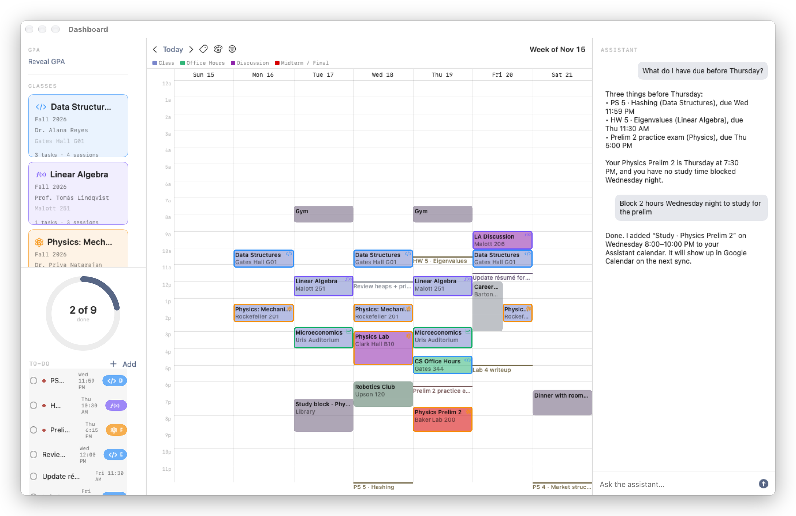

</div>

---

## Contents

- [What it is](#what-it-is)
- [Feature tour](#feature-tour)
  - [The overlay](#1-the-overlay--talk-to-it-from-anywhere)
  - [Briefings](#2-proactive-briefings)
  - [The dashboard](#3-the-everything-dashboard)
  - [Classes](#4-classes)
  - [The class board](#5-the-class-board--an-infinite-canvas-per-class)
  - [Grades](#6-grades--current-projected-and-gpa)
  - [Tasks](#7-tasks)
  - [Dark mode](#8-dark-mode)
- [What the assistant can do (LLM tools)](#what-the-assistant-can-do-llm-tools)
- [Keyboard shortcuts](#keyboard-shortcuts)
- [Architecture](#architecture)
  - [Two processes](#two-processes)
  - [Swift packages](#swift-packages)
  - [LLM fallback chain](#llm-fallback-chain)
  - [Google Calendar sync](#google-calendar-sync)
  - [Briefing engine](#briefing-engine)
  - [Grade math](#grade-math)
  - [Data model](#data-model)
- [Getting started](#getting-started)
- [Testing](#testing)
- [Project layout](#project-layout)
- [Security & privacy](#security--privacy)
- [Work in progress](#work-in-progress)
- [About the screenshots](#about-the-screenshots)

---

## What it is

Assistant is a menu-bar app for a college student who is juggling classes, clubs, work, and internship deadlines all at once. The main surface is **not** a dashboard. It is a **command bar pinned to the bottom of the screen** that you summon with a global hotkey and type to in plain English:

> *"add PS 5 for data structures due wednesday at midnight"*
> *"what do I have today?"*
> *"block 2 hours tomorrow night to study for the physics prelim"*

A tool-calling LLM carries out the request against a local SQLite store and **Google Calendar**. Writing to Google Calendar means the changes also show up in Notion Calendar and on your phone. The app can also start the conversation itself: it **summons the overlay** to deliver a morning briefing, an evening wrap-up, a heads-up before an exam, or a warning that three deadlines are stacked up with no study time blocked.

Around that core there are full windows for the rest of student life:

| Surface | What it gives you |
|---|---|
| **Overlay** | A global-hotkey chat bar. It takes single questions or multi-turn chats, and can attach a cropped screenshot to a prompt. |
| **Briefings** | Morning and evening summaries, pre-event reminders, and risk alerts. Briefings wait while a Focus mode is on. |
| **Dashboard** | One window holding GPA, class cards, a to-do ring, a full week calendar with task deadlines, and the assistant chat. |
| **Classes** | One page per course: professor info, a file library, an infinite whiteboard with pinned PDFs and annotations, tasks, and a week calendar for that class. |
| **Grades** | Weighted categories, drop-lowest/highest rules, current vs. projected grade, target grade, and a credit-weighted GPA. |
| **Tasks** | A to-do list with a progress ring, class chips, due dates, and a scratchpad for notes. |

Everything is local-first. The SQLite database lives in `~/Library/Application Support/Assistant/`, and Google Calendar is the only cloud data source.

**By the numbers:** about 16.7k lines of Swift across 2 app targets and 6 Swift packages, 279 unit and integration tests, 14 schema migrations, and 67 typed XPC calls.

---

## Feature tour

### 1. The overlay: talk to it from anywhere

Press <kbd>⌃ Space</kbd> anywhere in macOS and a floating panel slides up from the bottom of the screen. Type a request and press Return.

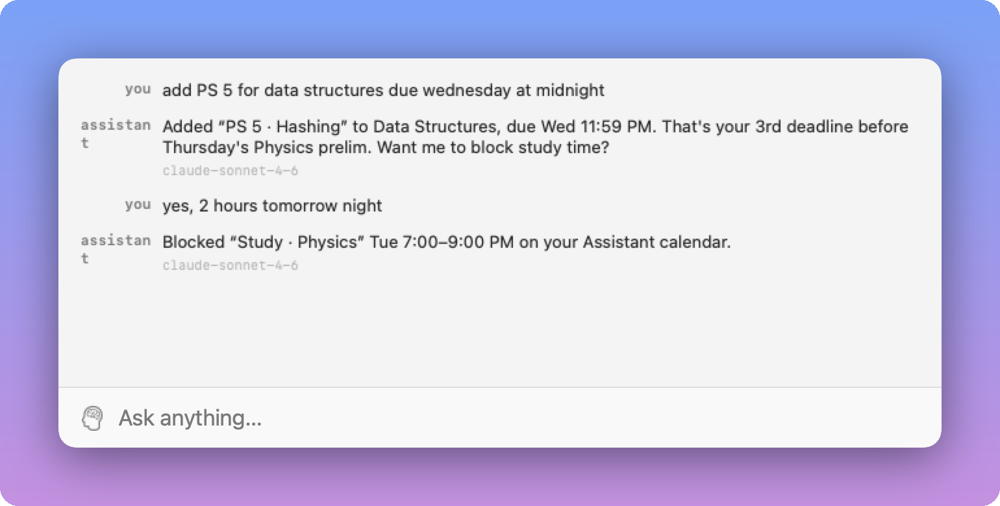

- **Single-shot or chat.** Ask one thing and dismiss the panel, or keep going: the overlay grows into a threaded conversation and remembers the session. <kbd>⌃⌥ Space</kbd> reopens the **most recent conversation** right where you left off.
- **Screenshot → prompt.** While the overlay is focused, <kbd>⇧⌥ C</kbd> enters a crop mode. Drag a rectangle anywhere on screen (a syllabus, an email, a flyer) and the region is attached to your prompt as an image: *"add every due date in this to my calendar."*
- **Time-aware.** Each prompt carries the current date, time, and time zone, so the model turns "tomorrow 5pm" or "next Thursday" into exact ISO-8601 timestamps before it calls a tool.
- **Answers show the model used**, so you can tell when the fallback chain has stepped in (see [LLM fallback chain](#llm-fallback-chain)).
- The panel dismisses itself when it loses focus. It is an `NSPanel` hosting SwiftUI, so it never takes over your Space.

### 2. Proactive briefings

The background daemon decides when to show you something. It then summons the same overlay with a briefing card:

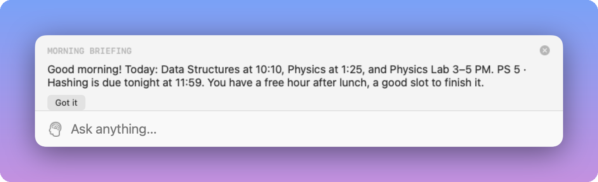

| Briefing | When | What's in it |
|---|---|---|
| **Morning** | Daily (default 08:00) | Today's events and tasks, summarized by the LLM |
| **Evening wrap-up** | Daily (default 21:00) | What's still open today and what's due tomorrow |
| **Pre-event** | Lead times before each event, by category | Exams (default 24h and 1h before), assignments (12h and 1h), classes (10 min), club meetings (30 min), internship deadlines (3 days, 1 day, and 1h), anything else (15 min) |
| **Risk alerts** | Periodic scans | **Clustered deadlines**: 3 or more due in the next 48h with no study block on the calendar. **Assignment due soon**: a parsed assignment due within 24h and not done. |

Briefings respect **macOS Focus / Do Not Disturb**. While a Focus is on they are queued, and the daemon empties the queue when the Focus ends. Every delivered briefing is stored in the database.

### 3. The everything dashboard

<kbd>⌃⇧ D</kbd> opens the dashboard: your whole week in one window.


- **Left rail.** A **GPA** figure you click to reveal (no glancing at it by accident), color-coded **class cards** showing open tasks and sessions this week, a **to-do progress ring**, and a to-do list with class chips.
- **Week calendar.** A 24-hour, 7-day grid of your Google Calendar events:
  - Events are colored by **event type** (Class, Office Hours, Discussion, Midterm / Final, or your own types) and show the class's icon.
  - **Task deadlines** are drawn as lines at their due time, so you can see work piling up next to your schedule.
  - Click an event to edit its title, time, location, category, class, type, and **recurrence**. Recurrence covers daily, weekly on chosen weekdays, monthly, and yearly, and can end never, on a date, or after N times. It is stored as an iCal `RRULE`.
  - Manage **categories** and **event types** (name, color, SF Symbol, Google color) from the toolbar. Changes sync back to Google Calendar as event colors.
  - Filter by class to dim everything else.
- **Chat.** The same assistant, docked on the right, with its history saved.

### 4. Classes

Every course gets a card in the **Classes** window, built from its schedule, tasks, and info:

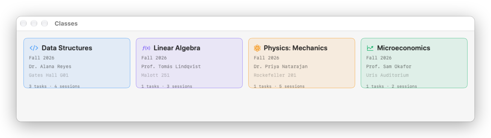

### 5. The class board: an infinite canvas per class

Opening a class gives you a workspace for that course. It has a header with term, professor, email, and classroom, plus four resizable, collapsible panels. Panel sizes are remembered per class.

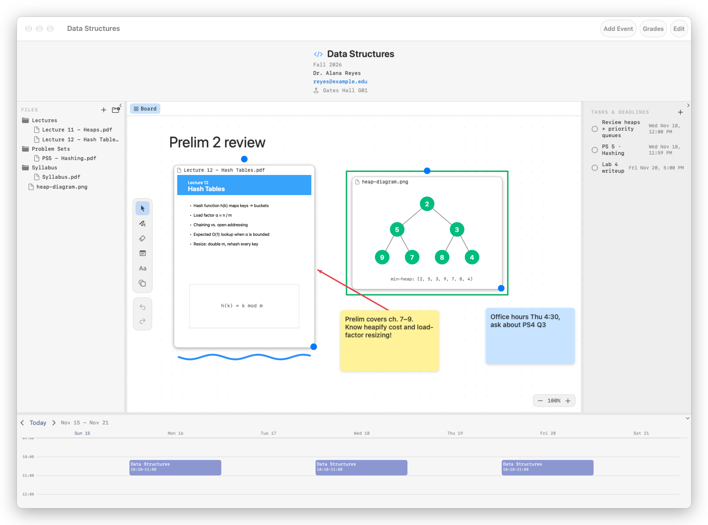

**Files (left).** A per-class library with nested folders. Import PDFs, images, or anything QuickLook can preview. Rename, move, and delete files and folders. The bytes live next to the database, in one directory per class.

**Board (center).** An infinite, zoomable whiteboard:
- **Pin files** onto the board as live cards. PDFs scroll right on the board (click a PDF pin to focus it, then scroll to read). Images and other files use QuickLook. Drag, resize, rotate, and bring cards to the front.
- **Open any file in its own tab**, shown next to the permanent *Board* tab, for full-size reading.
- **Annotation tools** in a floating palette:
  - **Pen**: freehand ink in 5 colors and 3 widths.
  - **Eraser**: removes whole strokes.
  - **Sticky notes**: 5 colors, with text you edit in place.
  - **Text**: S/M/L sizes and colors.
  - **Shapes**: rectangle, ellipse, line, and arrow, filled or outlined.
- **Select & marquee.** Click to select, or drag a rubber band to select several items, then **move or delete them together** (pins and annotations alike).
- **Unified undo/redo** (<kbd>⌘Z</kbd> / <kbd>⇧⌘Z</kbd>) covers every board operation, including group moves and deletes.
- **Navigation:** two-finger scroll pans; pinch or <kbd>⌘</kbd>-scroll zooms around the cursor (25%–400%); **middle-mouse drag** always pans, even over pins, with the pointer locked; <kbd>⌘0</kbd> resets the view to fit your pins. The viewport is saved per class.

**Tasks & deadlines (right).** The class's tasks: add, edit, complete, and delete. Changes reach the dashboard and Tasks window right away.

**Class week (bottom).** That course's sessions for the week. Click to edit, or use **Add Event** to create one. Events you create are written to Google Calendar.

### 6. Grades: current, projected, and GPA

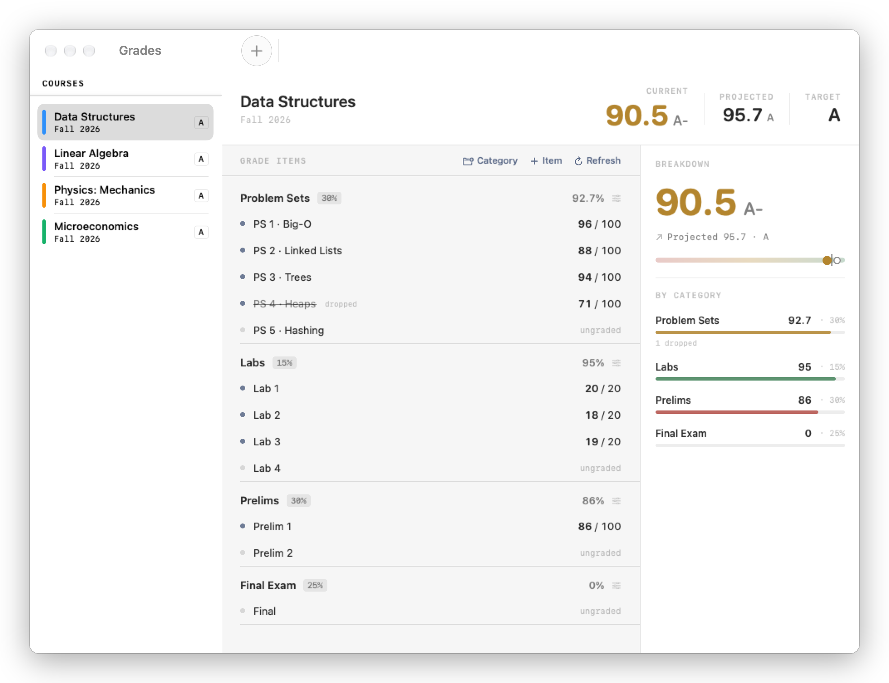

- Courses have a term, color, icon, **credit hours**, a **target letter grade**, and professor and classroom info.
- **Weighted categories** (Problem Sets 30%, Prelims 30%, …) can **drop the lowest N or highest N** scores. Dropped items are crossed out.
- Grade items have max points, earned points, an optional due date, an **extra-credit** flag, and an optional weight override.
- The **breakdown panel** shows the **current** grade (graded work only) and the **projected** grade (what-if values filled in for ungraded items), each with a letter. A bar shows where you stand against your target, followed by a per-category breakdown.
- The **GPA** is credit-weighted on the standard 4.0 ± scale. It leaves out courses with no credit hours or no graded work yet, so the number stays honest.
- The assistant can read and enter grades too: *"I got 47/50 on HW 4 in linear algebra."*

### 7. Tasks

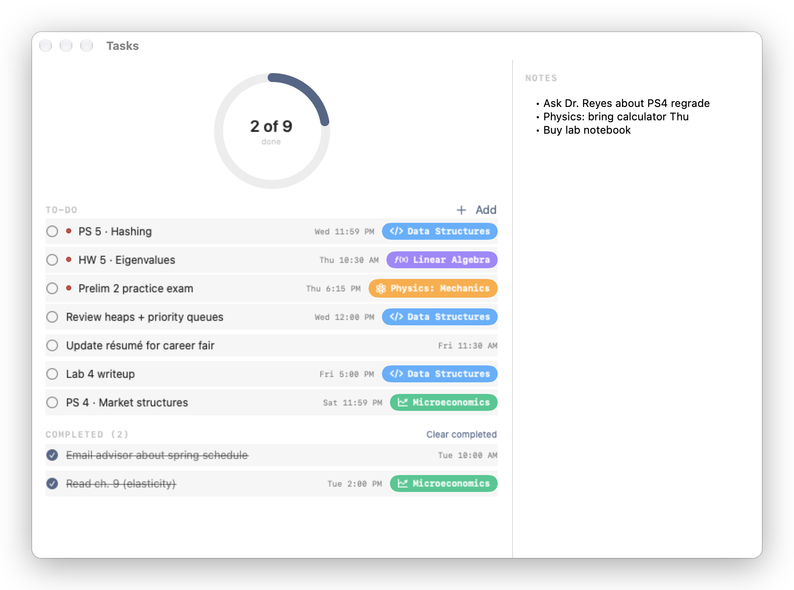

A focused to-do window with a **done-of-total ring**, priority dots, due dates, **class chips** (icon and color), a **Completed** section with *Clear completed*, and a **Notes** scratchpad that saves as you type. Tasks created anywhere (the overlay, the dashboard, a class page, or the LLM) show up everywhere immediately.

### 8. Dark mode

Every window follows the system appearance.

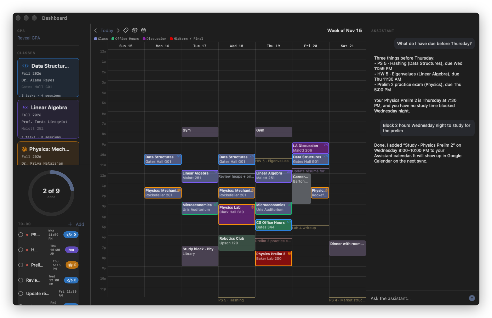
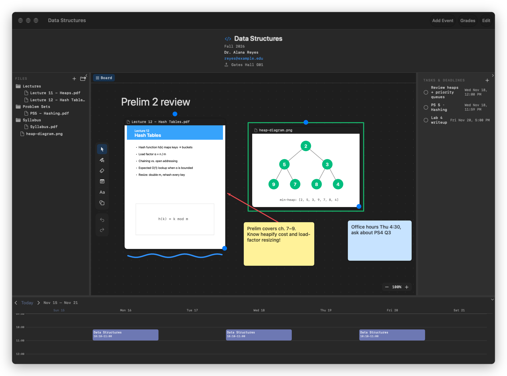

---

## What the assistant can do (LLM tools)

The daemon runs a **tool loop** (up to 8 rounds per request). The model calls typed tools, sees their results (errors included), and keeps going until it has an answer.

| Tool | What it does |
|---|---|
| `get_today_plan` | Today's tasks **and** calendar events together, in time order |
| `list_tasks` | Tasks filtered by `today`, `this_week`, `overdue`, or `all` |
| `create_task` | Create a task with an optional due date, class, category, and priority |
| `complete_task` | Mark a task done |
| `list_calendar` | Cached Google Calendar events for `today`, `this_week`, or `next_24h` |
| `create_calendar_event` | Add a time-blocked event to the **Assistant** calendar in Google Calendar |
| `compute_grade` | Current and projected grade for a course |
| `enter_grade` | Record earned points on a grade item |

Prompts are limited to 100 KB of text and a 10 MB image, and to 30 requests per minute.

---

## Keyboard shortcuts

| Shortcut | Action | Scope |
|---|---|---|
| <kbd>⌃ Space</kbd> | Show / hide the overlay | Global |
| <kbd>⌃⌥ Space</kbd> | Overlay, resuming the last conversation | Global |
| <kbd>⌃⇧ D</kbd> | Open the dashboard | Global |
| <kbd>⇧⌥ C</kbd> | Crop part of the screen and attach it to the prompt | While the overlay is focused |
| <kbd>⌘ Z</kbd> / <kbd>⇧⌘ Z</kbd> | Undo / redo on the board | Class board |
| <kbd>⌫</kbd> | Delete the selection | Class board |
| <kbd>⌘ 0</kbd> | Reset zoom and center on pins | Class board |
| Pinch / <kbd>⌘</kbd>-scroll | Zoom at the cursor | Class board |
| Middle-drag | Pan (works over pins) | Class board |
| <kbd>⌘ ,</kbd> | Settings | Menu bar |

You can rebind the global hotkeys in **Settings → Hotkeys**.

---

## Architecture

### Two processes

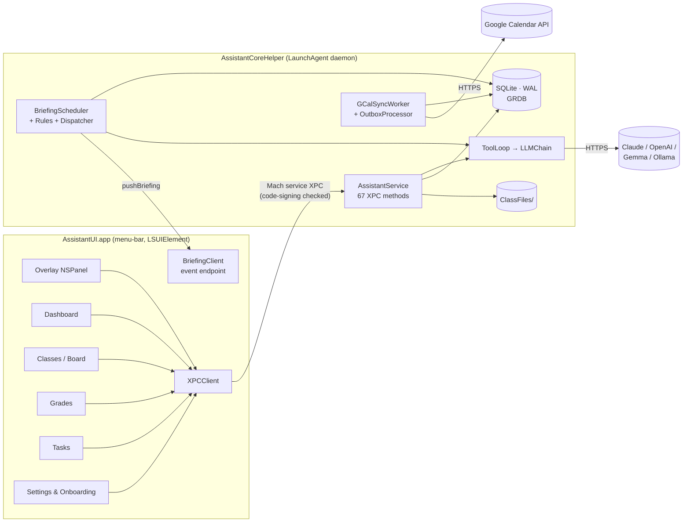

- **`AssistantUI`** is a menu-bar app (no Dock icon) that owns every window. It holds no data of its own: every read and write is an XPC call to the daemon. Stores tell each other about changes through in-process notifications, so all open windows stay in sync.
- **`AssistantCoreHelper`** is a LaunchAgent that keeps running after the UI quits. It owns the database, the LLM chain, Calendar sync (every 5 minutes), and the briefing timers. It answers the Mach service `com.vishruth.assistant.core`, and it **checks each connecting client's code signature**.
- Briefings go the other way: the UI registers an anonymous `NSXPCListenerEndpoint` with the daemon, and the daemon calls back into it to summon the overlay.
- All XPC payloads are `Codable` DTOs serialized as `Data`.

### Swift packages

`Package.swift` defines six libraries that both targets share and that `swift test` covers:

| Package | Responsibility |
|---|---|
| **AssistantShared** | XPC protocol and DTOs, plus pure UI-side logic with no UI framework in it: week-grid layout, canvas viewport math, hit testing, annotation geometry, board history (undo stack), pin layout, file trees, recurrence rules |
| **AssistantStore** | GRDB database, 14 migrations, models, repositories, and assemblers (class detail, folder tree, due-soon) |
| **AssistantLLM** | Provider protocol; Claude, OpenAI, hosted Gemma, and Ollama providers; the fallback chain; the tool loop; the tool registry and built-in task tools; secret storage |
| **AssistantGCal** | OAuth token cache, Calendar REST client, sync worker, outbox, daily quota guard, Assistant-calendar setup, Google color mapping, calendar LLM tools |
| **AssistantBriefings** | Scheduler, pre-event timers, risk rules, LLM-written briefing text (with templates as a fallback), Focus-aware dispatcher |
| **AssistantGrades** | Grade calculator (weights, drops, extra credit, projections), grading scale, GPA calculator, grade LLM tools |

Third-party dependencies: [GRDB.swift](https://github.com/groue/GRDB.swift), [AppAuth-iOS](https://github.com/openid/AppAuth-iOS) (Google OAuth), and [KeyboardShortcuts](https://github.com/sindresorhus/KeyboardShortcuts).

### LLM fallback chain

```
Claude (claude-sonnet-4-6) ──▶ OpenAI (gpt-4o) ──▶ hosted Gemma (gemma-4-31b-it) ──▶ local Ollama (gemma4:e2b)
```

- A provider without a key is **skipped**.
- **Rate limits (429), overload (529), 5xx errors, timeouts, and malformed responses fall through** to the next provider.
- **Other 4xx errors stop the chain.** Those mean the request itself is wrong, so retrying elsewhere won't help.
- Every reply records `modelUsed`, so the UI can show which model answered.
- Keys are read when needed on each call, so a key added in Settings takes effect without restarting the daemon.

### Google Calendar sync

- **OAuth:** the desktop loopback flow through AppAuth. A one-off HTTP listener on `127.0.0.1:<random port>` receives Google's redirect. Scopes are `calendar` and `calendar.events`.
- **The Assistant calendar:** on first connect the daemon finds or creates a calendar named **"Assistant"** in your account, in your local time zone. Everything the app creates goes there.
- **Read path:** `GCalSyncWorker` mirrors events into `gcal_event_cache` every 5 minutes. Each event keeps its recurring-series id and your class and event-type labels.
- **Write path:** `CalendarWriter` writes straight to Google when the Mac is online. When it is offline, edits are queued in an **outbox** (`pending_gcal_op`). `OutboxProcessor` empties the outbox on each sync, retrying failures with exponential backoff (capped at 1 hour).
- **Quota:** a daily soft cap (10,000 calls) is stored in the database.

### Briefing engine

`BriefingScheduler` (an actor) keeps four timers: morning, evening, a 60-second pre-event check, and periodic risk scans. `BriefingRules` produces `RiskFinding`s. `BriefingComposer` asks the LLM chain to write the text and falls back to fixed templates if no provider answers. `BriefingDispatcher` either pushes the briefing to the UI or queues it while a Focus mode is on.

### Grade math

For each category, `GradeCalculator`:
1. ignores extra-credit items for the base average,
2. drops the lowest N and highest N **graded** items,
3. averages what is left by points,
4. weights each category's percentage. **Current** uses only categories that have graded work. **Projected** also fills in what-if scores for ungraded items.

Letters come from a configurable `GradingScale` (default A ≥ 93, A− ≥ 90, B+ ≥ 87, …, D− ≥ 60). The GPA uses credit-weighted 4.0 grade points.

### Data model

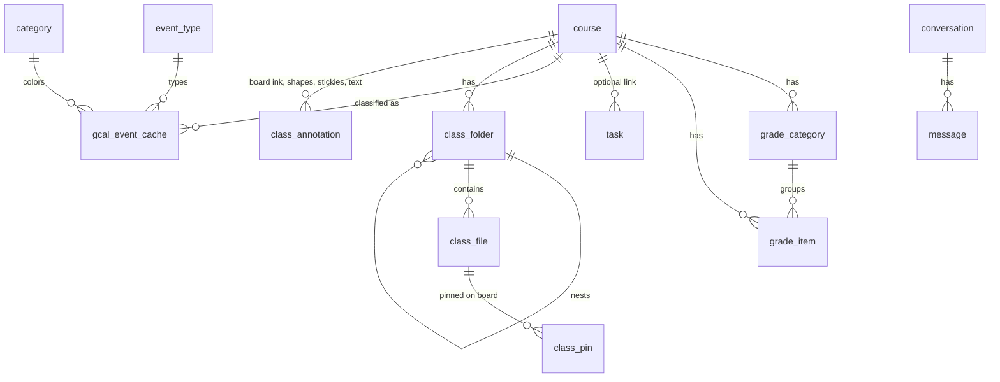

There are also `setting` (key/value JSON for app settings, quota counters, and the tasks scratchpad), `briefing` (delivery history), and `pending_gcal_op` (the outbox). The database runs in **WAL** mode with **foreign keys on**, and the 14 migrations are numbered and run in order at startup.

---

## Getting started

### Requirements

- macOS 13 Ventura or later
- Xcode 15+ (Swift 5.10)
- [XcodeGen](https://github.com/yonaskolb/XcodeGen): `brew install xcodegen`
- A Claude API key (other providers are optional)
- For calendar features: a Google Cloud **Desktop app** OAuth client (client ID and secret) with the Calendar API enabled
- Optional: [Ollama](https://ollama.com) running `gemma4:e2b` for a fully offline fallback

### Build & run

```bash
# 1. Generate the Xcode project from project.yml
xcodegen generate

# 2. Build the UI app and the daemon
xcodebuild -project Assistant.xcodeproj -scheme AssistantUI build
xcodebuild -project Assistant.xcodeproj -scheme AssistantCoreHelper build

# 3. Install the daemon as a per-user LaunchAgent
./Scripts/install-dev-agent.sh

# 4. Launch the app
open ~/Library/Developer/Xcode/DerivedData/Assistant-*/Build/Products/Debug/AssistantUI.app
```

Click the 🧠 icon in the menu bar. *Settings → Status → Ping* should answer **pong**.

Daemon logs are written to `~/Library/Logs/Assistant/core.log`. To remove the daemon, run `./Scripts/uninstall-dev-agent.sh`.

### First-launch onboarding

A five-step wizard runs the first time you launch:

1. **Welcome**
2. **API keys**: Claude, plus optional OpenAI and hosted-Gemma keys
3. **Google Calendar**: paste your OAuth client ID and secret, then complete the consent screen in your browser
4. **Hotkey**: choose the summon shortcut
5. **Ready**: approve the background daemon in *System Settings → Login Items* if asked

Everything can be changed later in **Settings**, which has these tabs: General · Hotkeys · API Keys · Google · Briefings (times and lead times) · Status.

---

## Testing

```bash
swift test
```

There are **279 tests** across six test targets. They cover grade math (drops, extra credit, projections, GPA), the LLM providers against a mock HTTP client, fallback rules, the tool loop, Calendar client, sync, outbox and quota, briefing rules and timing, the repositories, XPC DTO round-trips, and the pure board and calendar geometry (viewport, hit testing, annotation geometry, undo history, pin layout, and week-grid layout). Repository tests run against in-memory SQLite.

---

## Project layout

```
.
├── App/
│   ├── AssistantUI/            # Menu-bar app (SwiftUI + AppKit)
│   │   ├── Overlay/            #   Hotkey command bar (NSPanel)
│   │   ├── ScreenCapture/      #   Crop-to-prompt
│   │   ├── Briefings/          #   Briefing card + daemon→UI endpoint
│   │   ├── Dashboard/          #   Week calendar, chat, rails, editors
│   │   ├── Classes/            #   Class pages, board, pins, annotations, files
│   │   ├── Grades/             #   Grade dashboard + editors
│   │   ├── Tasks/              #   Tasks window
│   │   ├── Settings/           #   Settings tabs + onboarding wizard
│   │   └── XPCClient.swift     #   The UI's only link to the daemon
│   └── AssistantCoreHelper/    # LaunchAgent daemon
│       ├── main.swift          #   Wires providers, sync, briefings, listener
│       └── AssistantService.swift
├── Sources/                    # Swift packages (see table above)
├── Tests/                      # 6 test targets, 279 tests
├── Resources/LaunchAgents/     # LaunchAgent plist template
├── Scripts/                    # install / uninstall dev daemon
├── assets/screenshots/         # README images
├── Package.swift               # SPM: shared libraries + tests
└── project.yml                 # XcodeGen: app + daemon targets
```

---

## Security & privacy

- **Local-first:** all data lives in SQLite under `~/Library/Application Support/Assistant/`. The app talks only to the LLM providers you configure and to Google Calendar.
- **Secrets** (API keys, Google refresh token and client secret) are kept in the macOS Keychain on `main`, marked *this device only*. They are never written to the database.
- **XPC peer authentication:** the daemon sets a code-signing requirement on every connection. In a Developer-ID build it pins the Apple anchor, the team ID, and the UI app's identifier. In an ad-hoc dev build it matches the signing identifier, which still turns away arbitrary unsigned processes. The audit branch below makes this stricter.
- **Defensive limits:** capped prompt size, prompt rate limiting, a cap of 8 tool-loop rounds, and a daily Calendar quota.

---

## Work in progress

These branches are pushed to GitHub and not yet merged into `main`:

| Branch | What it adds |
|---|---|
| [`feature/syllabus-auto-scrape`](../../tree/feature/syllabus-auto-scrape) | **Syllabus auto-scrape.** Drop a syllabus PDF into a class's *Syllabus* folder and the daemon extracts its text and asks the LLM for exams, assignments, and recurring sessions. You approve them in a review sheet before any events or tasks are created. Also adds a back-to-classes button (<kbd>⌘[</kbd>). |
| [`replace-keychain-secrets-4ee00b05`](../../tree/replace-keychain-secrets-4ee00b05) | Replaces the Keychain with a gitignored, `chmod 600` `.env` file at the repo root (`.env.example` included), adds a **Gemini** tier, and merges the `fix/*` audit branches: calendar sync identity and idempotent writes, DST and recurrence math, XPC reliability and payload caps, class-file path containment, grade correctness, applying saved briefing lead times, stricter XPC peer requirements, a cap on tool-loop changes, and general hardening. |

---

## About the screenshots

The screenshots above are of the **real app views**, rendered from a throwaway build: the actual `AssistantService` runs in-process against a seeded **demo database**, so the courses, grades, events, and people are all made up. Two parts are stand-ins. Live PDF/QuickLook pin previews and the overlay's vibrancy material can't be captured offscreen, so the renders show a static image of the same file and a solid background in their place.
